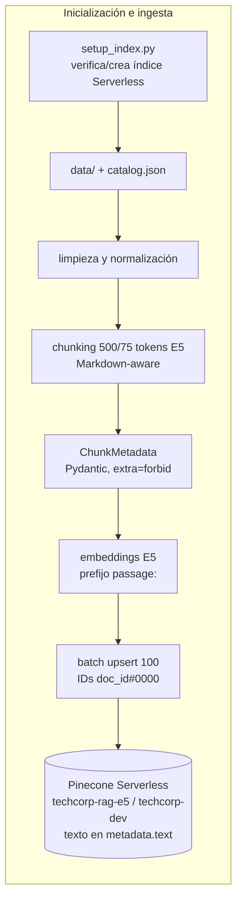
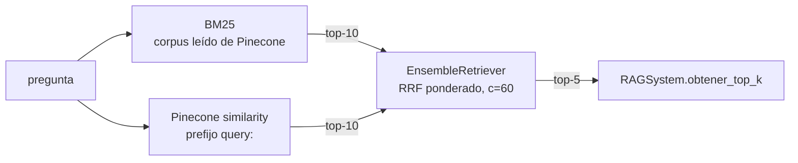

# RAG híbrido con Pinecone — Módulo de recuperación escalable

Pre-entrega 4 del curso AI Engineering. Módulo de **recuperación** (sin generación con LLM) sobre documentación
técnica e interna de la empresa ficticia **TechCorp**, incluida la documentación de su librería de Python interna
`techcorp-sdk`:

- **`setup_index.py`**: verifica si el índice existe en **Pinecone Serverless** y lo crea si hace falta, validando
  dimensión y métrica.
- **`ingest.py`**: pipeline de ingesta que limpia, fragmenta (500 tokens E5, overlap 75), enriquece con metadatos
  estrictos y sube a Pinecone con **batch upsert**, con el **texto original y la fuente en la metadata**. No reindexa
  lo que no cambió.
- **`RAGSystem`**: recuperador híbrido **BM25 + Pinecone** fusionado con `EnsembleRetriever` (Reciprocal Rank Fusion
  ponderada) y filtros por metadata. Devuelve el **top-5**.
- **`evaluate.py`**: **Recall@5** y **Precision@5** (más F1, Hit Rate, MRR, nDCG y evidencias) sobre el **benchmark de
  5 preguntas** de la consigna y un Golden Set ampliado de 26 casos. Compara bm25, vectorial e híbrido e **imprime el
  resumen en consola**.





## Estructura

```
data/                 11 documentos (6 técnicos, 3 de ellos de techcorp-sdk) + catalog.json
eval/                 golden_set.json (26 casos, 5 "nucleo") + lectura_resultados.md
reports/              eval_report.md (generado por evaluate.py y versionado)
rag_pinecone/         config, embeddings, schemas, text_processing, pinecone_index, ingestion,
                      filters, retrievers, rag_system, evaluation/{metrics,runner}
setup_index.py  ingest.py  evaluate.py  query.py
tests/                suite offline (fakes de Pinecone) + test_integration.py
```

## Decisiones de diseño (y por qué)

| Decisión | Por qué |
|---|---|
| **Embeddings `intfloat/multilingual-e5-small`** (384 dims, 512 tokens) en vez de `all-MiniLM-L6-v2` | MiniLM está entrenado en inglés y trunca a 256 tokens: con chunks de 500–800 tokens perdería más de la mitad de cada chunk sin avisar. E5 es multilingüe, corre en CPU y no necesita API key. Usa los prefijos `passage:` y `query:`. |
| **384 dimensiones, no 1536** | 1536 es la dimensión de `text-embedding-3-small` (OpenAI). La dimensión **se deriva del modelo en runtime** (`len(embed_query("probe"))`) y nunca se escribe a mano. OpenAI también está soportado (`EMBEDDING_PROVIDER=openai`), con su propio índice. |
| **Chunk medido con el tokenizer del embedder** | `tiktoken` no mide lo que trunca E5. Se valida `chunk_size + prefijo + tokens especiales ≤ 512` (`CHUNK_SIZE=600` falla con `ChunkTooLongError`). |
| **IDs determinísticos `{doc_id}#{chunk_index:04d}` + `content_hash`** | Volver a ejecutar no duplica vectores (el notebook pasaba de 16 a 20). Un documento sin cambios no se re-embebe, uno que cambió se reemplaza sin dejar chunks huérfanos y `--prune` borra los documentos eliminados. |
| **Esquema único `ChunkMetadata` + `catalog.json`** | Evita el *Schema Drift*: los filtros validan sus claves contra el esquema, de modo que un filtro mal escrito **falla en voz alta** en lugar de devolver 0 resultados. |
| **Texto original en `metadata["text"]`** | Pinecone devuelve el contenido sin consultar otra base. |
| **Corpus BM25 leído desde Pinecone** | BM25 y el retriever vectorial ven los mismos chunks con el mismo `chunk_id`, así la fusión deduplica bien. Pinecone es la única fuente de verdad. |
| **Preprocesamiento BM25 en español** | Sin tildes, minúsculas, tokens con guiones/puntos y sin stopwords: `(2FA)`→`2fa`, `VPN-809`→`vpn-809`, `días`→`dias`. |
| **RRF ponderada, nunca suma de scores** | Los scores BM25 y coseno no son comparables. RRF combina **rankings**: `Σ wᵢ/(c + rankᵢ)`. |
| **`candidate_k=10` > `top_k=5`** | Le da margen a la fusión para reordenar antes de recortar. |
| **Precision@5 con techo** | Si la única respuesta es un documento de 1 chunk, Precision@5 no puede superar 0,20. Se informa el techo y la precisión normalizada. |
| **`techcorp-sdk` ficticia** | Evita problemas de licencia, da hechos exactos y estables para el Golden Set y no depende de la red. |

## Requisitos

- Python 3.12.
- Cuenta gratuita en [app.pinecone.io](https://app.pinecone.io) (plan Starter, `aws`/`us-east-1`).
- `OPENAI_API_KEY` solo si se usa `EMBEDDING_PROVIDER=openai`.
- ~500 MB de disco para el modelo E5, que se descarga a la caché de HuggingFace la primera vez.

## Setup

PowerShell (Windows):

```powershell
python -m venv .venv
.\.venv\Scripts\Activate.ps1
pip install torch --index-url https://download.pytorch.org/whl/cpu   # opcional, evita bajar CUDA
pip install -r requirements.txt
copy .env.example .env   # completar PINECONE_API_KEY e INDEX_NAME (y OPENAI_API_KEY si aplica)
```

bash (Linux/macOS):

```bash
python -m venv .venv && source .venv/bin/activate
pip install -r requirements.txt && cp .env.example .env
```

Versiones verificadas en `requirements.lock.txt` (`langchain-core 1.6.6`, `langchain-classic 1.0.8`,
`langchain-pinecone 0.2.13`, `pinecone 7.3.0`, `sentence-transformers 6.1.0`, `transformers 5.18.0`). No instalar
`pinecone-client`: está deprecado y entra en conflicto con `pinecone`. `langchain-community` emite un
`DeprecationWarning` al importar `BM25Retriever`; es esperable.

## Replicar el índice de Pinecone

Ejecutar todos los comandos desde la raíz del repo.

**1. API key y `.env`.** En la consola de Pinecone: *API Keys → Create API key*. Completar en `.env` las variables
que pide la consigna:

| Variable | Valor |
|---|---|
| `PINECONE_API_KEY` | key de Pinecone |
| `INDEX_NAME` | `techcorp-rag-e5` (no reutilizar `techcorp-rag-hibrido` del notebook: tiene la misma dimensión pero **otro modelo**) |
| `OPENAI_API_KEY` | solo con `EMBEDDING_PROVIDER=openai` |
| `ANTHROPIC_API_KEY` | declarada en `.env.example` como alternativa para la etapa de generación; esta entrega no la usa |

**2. Crear el índice serverless**. Se ejecuta dos veces para mostrar la idempotencia:

```text
> python setup_index.py
INFO rag_pinecone Creando índice serverless 'techcorp-rag-e5' (dim 384, cosine, aws/us-east-1)
🆕 Índice 'techcorp-rag-e5' creado (Serverless aws/us-east-1, dim 384, cosine) — listo en 6.3 s
   Namespace 'techcorp-dev': 0 vectores → siguiente paso: python ingest.py

> python setup_index.py
♻️ Índice 'techcorp-rag-e5' ya existe — dimensión 384 ✓, métrica cosine ✓ — no se vuelve a crear
   Namespace 'techcorp-dev': 0 vectores → siguiente paso: python ingest.py
```

Si el índice existe con otra dimensión o métrica, el script termina con exit code 1 y explica qué hacer. Nunca borra
índices. `python setup_index.py --check` solo verifica, sin crear nada.

**3. Ingesta.** `python ingest.py --dry-run` muestra lo mismo sin escribir nada.

```text
> python ingest.py
INFO rag_pinecone Lote 1/1: 28 vectores en 4403 ms
INFO rag_pinecone Ingesta completa: {'nuevo': 11} | subidos=28 borrados=0 | vectores en 'techcorp-dev'=28 | 9.3 s
archivo                             | estado | chunks | tokens máx | subidos | borrados
------------------------------------+--------+--------+------------+---------+---------
onboarding_nuevos_empleados.txt     | nuevo  | 1      | 185        | 1       | 0
politica_seguridad_informatica.txt  | nuevo  | 1      | 207        | 1       | 0
politica_teletrabajo.txt            | nuevo  | 1      | 213        | 1       | 0
politica_vacaciones.txt             | nuevo  | 1      | 220        | 1       | 0
guia_acceso_remoto_vpn.md           | nuevo  | 3      | 491        | 3       | 0
manual_beneficios_y_licencias.md    | nuevo  | 6      | 486        | 6       | 0
politica_gastos_y_viajes.md         | nuevo  | 3      | 479        | 3       | 0
procedimiento_gestion_incidentes.md | nuevo  | 3      | 435        | 3       | 0
sdk_errores_y_reintentos.md         | nuevo  | 3      | 435        | 3       | 0
sdk_instalacion_configuracion.md    | nuevo  | 3      | 477        | 3       | 0
sdk_referencia_cliente.md           | nuevo  | 3      | 480        | 3       | 0

subidos=28 borrados=0 tiempo=9.3 s
Índice: techcorp-rag-e5 (dim 384, cosine, aws/us-east-1) | Namespace: techcorp-dev | Vectores: 28
```

**4. Verificar el índice:**

```text
> python ingest.py --stats
dimension: 384 | metric: cosine | total_vector_count: 28
  namespace 'techcorp-dev': vector_count=28  ← configurado
```

**5. Idempotencia.** Una segunda ingesta no sube nada:

```text
> python ingest.py
INFO rag_pinecone Ingesta completa: {'sin_cambios': 11} | subidos=0 borrados=0 | vectores en 'techcorp-dev'=28 | 6.3 s
...
Índice: techcorp-rag-e5 (dim 384, cosine, aws/us-east-1) | Namespace: techcorp-dev | Vectores: 28
```

**6. Empezar de cero:**
- `python ingest.py --reset-namespace --yes` borra solo los vectores del namespace.
- También se puede borrar el índice desde la consola de Pinecone.
- `python ingest.py --force` reindexa todo.
- `python ingest.py --prune` borra los vectores de documentos que ya no están en `data/`.

**7. Otro proveedor o modelo de embeddings:** cambiar `EMBEDDING_PROVIDER`/`EMBEDDING_MODEL` **y también**
`INDEX_NAME` (la dimensión de un índice no se puede cambiar), y repetir `setup_index.py` + `ingest.py`. Si un
namespace fue indexado con otro modelo, `ingest.py` lo detecta (`EmbeddingModelMismatchError`) y sugiere `--force`.

| Proveedor | Modelo | Dim | `INDEX_NAME` | Costo |
|---|---|---|---|---|
| `huggingface` (default) | `intfloat/multilingual-e5-small` | 384 | `techcorp-rag-e5` | gratis, local, sin red tras la descarga |
| `openai` | `text-embedding-3-small` | 1536 | `techcorp-rag-oai-1536` | API paga, requiere `OPENAI_API_KEY` |

## Uso

```powershell
python query.py "¿Qué significa el error VPN-809?"
python query.py "¿Con cuántos días de anticipación hay que solicitarlo?" --filtro department=finanzas
python query.py "..." --modo bm25 --k 3
python query.py "..." --filtro effective_year>=2026 --filtro tags=vpn,2fa
python query.py "¿Qué significa el error VPN-809?" --diagnostico --k 3
python query.py          # modo interactivo; 'salir' termina
```

Salida real de `--diagnostico`, que muestra en qué posición puso cada retriever a cada resultado antes de la fusión:

```text
1. [guia_acceso_remoto_vpn.md | acceso remoto | Configuración de red y dispositivos permitidos] guia_acceso_remoto_vpn#0001  [bm25 #1 | vectorial #1]
   ## Configuración de red y dispositivos permitidos En TechCorp el split tunneling está deshabilitado: ...
2. [sdk_errores_y_reintentos.md | techcorp-sdk | Jerarquía de excepciones] sdk_errores_y_reintentos#0000  [bm25 #2 | vectorial #2]
3. [sdk_instalacion_configuracion.md | techcorp-sdk | Requisitos] sdk_instalacion_configuracion#0000  [bm25 #5 | vectorial #4]
```

Uso programático:

```python
from rag_pinecone import RAGSystem, Settings

rag = RAGSystem.from_settings(Settings.from_env())
rag.obtener_top_k("¿Qué significa el error VPN-809?")          # [{'contenido', 'fuente', 'categoria', 'rank', 'chunk_id', ...}]
rag.obtener_top_k("¿Con cuántos días de anticipación hay que solicitarlo?", filtros={"department": "finanzas"})
rag.recuperar("SEV3", modo="bm25")                              # list[Document]
```

## Evaluación — resumen de resultados

```powershell
python evaluate.py --sweep-pesos     # agregar --strict para exit code 1 si no se cumplen umbrales
```

Salida real de consola (pesos finales bm25=0.3, vectorial=0.7; reporte completo en
[reports/eval_report.md](reports/eval_report.md)):

```text
==================== BENCHMARK CONSIGNA (5 preguntas, k=5, hibrido) ====================
✅ q01 ¿Cuánto descanso anual me corresponde si llevo seis años trabajando en la emp...
   Esperado: politica_vacaciones.txt | Top-5: politica_vacaciones.txt, manual_beneficios_y_licencias.md, manual_beneficios_y_licencias.md, politica_gastos_y_viajes.md, manual_beneficios_y_licencias.md
   Recall@5: 100.0% | Precision@5: 20.0% (techo 20.0%)
✅ q08 Se cayó el servicio principal y se filtraron datos, ¿en cuánto tiempo tienen ...
   Esperado: procedimiento_gestion_incidentes.md | Top-5: procedimiento_gestion_incidentes.md, sdk_errores_y_reintentos.md, procedimiento_gestion_incidentes.md, guia_acceso_remoto_vpn.md, guia_acceso_remoto_vpn.md
   Recall@5: 100.0% | Precision@5: 40.0% (techo 60.0%)
✅ q10 ¿Qué significa el error VPN-809?
   Esperado: guia_acceso_remoto_vpn.md | Top-5: guia_acceso_remoto_vpn.md, sdk_errores_y_reintentos.md, sdk_instalacion_configuracion.md, sdk_errores_y_reintentos.md, sdk_errores_y_reintentos.md
   Recall@5: 100.0% | Precision@5: 20.0% (techo 60.0%)
✅ q23 ¿Qué excepción lanza techcorp-sdk ante un HTTP 429?
   Esperado: sdk_errores_y_reintentos.md | Top-5: sdk_errores_y_reintentos.md, sdk_errores_y_reintentos.md, sdk_instalacion_configuracion.md, sdk_referencia_cliente.md, sdk_instalacion_configuracion.md
   Recall@5: 100.0% | Precision@5: 40.0% (techo 60.0%)
✅ q24 ¿Cómo instalo la librería interna de Python y qué versión del intérprete nece...
   Esperado: sdk_instalacion_configuracion.md | Top-5: sdk_instalacion_configuracion.md, sdk_referencia_cliente.md, sdk_instalacion_configuracion.md, sdk_errores_y_reintentos.md, sdk_errores_y_reintentos.md
   Recall@5: 100.0% | Precision@5: 40.0% (techo 60.0%)
📊 RECALL@5 PROMEDIO:    100.0%
📊 PRECISION@5 PROMEDIO: 32.0%  (techo promedio 52.0% → precisión normalizada 66.7%)

================================ RESUMEN (k=5, 26 casos) ================================
            P@5        P@5 norm   R@5        F1@5       Hit@5      MRR        nDCG@5     Evid.
bm25        0.34       0.64       0.92       0.47       0.96       0.83       0.63       0.92
vectorial   0.50       0.86       1.00       0.64       1.00       1.00       0.88       1.00
hibrido     0.45       0.79       1.00       0.60       1.00       1.00       0.82       1.00

Por tipo de pregunta (hibrido):
            P@5        P@5 norm   R@5        F1@5       Hit@5      MRR        nDCG@5     Evid.
filtrada    0.60       1.00       1.00       0.75       1.00       1.00       0.98       1.00
lexica      0.36       0.74       1.00       0.51       1.00       1.00       0.77       1.00
multi_doc   0.64       0.86       1.00       0.77       1.00       1.00       0.87       1.00
semantica   0.42       0.77       1.00       0.56       1.00       1.00       0.81       1.00

Casos filtrados evaluados SIN filtro (valor del hard filter, híbrido):
  q21: R@5 con filtro 1.00 → sin filtro 0.00 | top-1 sin filtro: politica_vacaciones.txt
  q22: R@5 con filtro 1.00 → sin filtro 0.00 | top-1 sin filtro: manual_beneficios_y_licencias.md

============================== BARRIDO DE PESOS (bm25, vectorial) ==============================
            P@5        P@5 norm   R@5        F1@5       Hit@5      MRR        nDCG@5     Evid.
0.3/0.7     0.45       0.79       1.00       0.60       1.00       1.00       0.82       1.00
0.4/0.6     0.45       0.79       1.00       0.60       1.00       0.98       0.81       1.00
0.5/0.5     0.44       0.77       1.00       0.58       1.00       0.97       0.79       1.00
0.6/0.4     0.42       0.74       0.98       0.56       1.00       0.97       0.77       0.98
0.7/0.3     0.42       0.73       0.98       0.55       1.00       0.91       0.73       0.98
Mejor combinación por (MRR, Recall@5, Precision@5): bm25=0.3 vectorial=0.7

Conclusión breve:
- El híbrido iguala o supera al mejor retriever individual (vectorial) en Recall@5 (1.00 vs 1.00); MRR 1.00 vs 1.00.
- Preguntas léxicas: empate (MRR bm25 1.00 vs vectorial 1.00).
- Preguntas semánticas: gana el vectorial (MRR bm25 0.67 vs vectorial 1.00).
- El híbrido recupera todos los documentos esperados en todos los casos (recall=1).
✅ --strict: el híbrido cumple todos los umbrales.
```

### Lectura

- **Consigna cumplida:** las 5 preguntas del benchmark traen su documento fuente en el **top-1** (Recall@5 = 100%).
  Precision@5 = 32% contra un techo alcanzable de 52%: q01 apunta a un documento de un solo chunk, cuyo techo es 20%.
- **BM25 solo es el más débil** (Recall 0,92, MRR 0,83). Falla en paráfrasis sin palabras en común; el caso extremo
  es q05 ("no soy quien gesta" ↔ "licencia parental").
- **E5 es muy fuerte en este corpus chico:** el vectorial solo llega a Recall y MRR 1,00 y empata con BM25 incluso
  en códigos exactos (VPN-809, SEV3, GastosTC).
- **Pesos 0,3/0,7, elegidos con el barrido.** Con 0,5/0,5, BM25 empujaba el documento correcto de q05 al 4.º lugar
  (MRR 0,97); con 0,3/0,7 el MRR vuelve a 1,00. Dar más peso a BM25 empieza a perder documentos. El costo del
  híbrido es una Precision@5 algo menor que la del vectorial puro (0,45 vs 0,50): BM25 suma chunks que comparten
  términos genéricos.
- **El hard filter es imprescindible en preguntas ambiguas:** sin filtro, q21 y q22 tienen Recall 0; con
  `department` llegan a 1.
- **Conclusión honesta:** con 28 chunks y un embedder multilingüe moderno, la ventaja del híbrido es de
  **robustez** (red de seguridad léxica), no de métricas. Se espera que crezca con corpus grandes llenos de
  identificadores casi duplicados.

### Métricas

| Métrica | Definición |
|---|---|
| **Recall@5** | `|docs esperados ∩ fuentes del top-5| / |docs esperados|`. Con un documento esperado (todo el benchmark de la consigna) responde literalmente "¿está el documento correcto entre los 5 recuperados?" (0 o 1). En las preguntas multi-documento (q17–q20, q26) vale 0, 0,5 o 1: ya no es binario. |
| **Precision@5** | `chunks del top-5 cuya fuente es un documento esperado / 5`: "¿qué porcentaje de los 5 recuperados son realmente útiles?". Siempre se divide por 5, aunque se recuperen menos chunks. |
| **Techo de Precision@5** | `min(5, chunks de los documentos esperados) / 5`. La **P@5 norm** es precisión / techo. |
| **Hit@5, MRR, nDCG@5** | Hit: algún relevante en el top-5. MRR: 1 / posición del primer relevante. nDCG: ganancia binaria por chunk relevante. |
| **Evid.** | Fracción de evidencias del Golden Set (ej. "TCP 443") presentes, con límites de palabra, en los chunks recuperados de documentos relevantes. Mide que se recuperó el *fragmento* correcto. |

### Golden Set ([eval/golden_set.json](eval/golden_set.json))

26 casos: 10 semánticos, 9 léxicos, 5 multi-documento y 2 filtrados.

- **Benchmark de la consigna (`nucleo: true`):** q01, q08, q10, q23 y q24, con un único documento fuente conocido.
  Cuatro son sobre documentos técnicos.
- **Léxicas (q10–q16, q23, q25):** códigos o siglas exactas.
- **Semánticas (q01–q09, q24):** paráfrasis sin las palabras del documento.
- **Filtradas (q21–q22):** ambiguas a propósito; "días de anticipación" aparece en vacaciones, mudanza y viajes.
- **`tests/test_dataset.py`** verifica que cada evidencia aparezca en sus documentos esperados.

## Tests

```text
> pytest -q                       # offline: sin red ni API keys (FakePineconeIndex + embeddings deterministas)
134 passed, 4 deselected

> pytest -m integration -q        # Pinecone real + E5 real, namespace efímero test-<uuid8> borrado al final
4 passed, 134 deselected in 53.46s
```

La suite offline cubre:
- validaciones de config y esquemas;
- filtros, comparados contra una implementación de referencia de la semántica de Pinecone;
- limpieza y chunking;
- dataset: hashes SHA-256 de los documentos, frases literales, términos prohibidos y evidencias;
- `setup_index` (crea, idempotente, mismatch, `--check`);
- ingesta: sin cambios sin re-embeber, sin huérfanos, `prune`, `force`, lotes 100/100/50, reintentos, `dry-run`;
- BM25 y la fusión RRF con retrievers stub;
- métricas calculadas a mano;
- la salida de consola de `evaluate.py` y `--strict`.

## Esquema de metadata (`ChunkMetadata`)

| Campo | Tipo | Origen | Filtrable |
|---|---|---|---|
| `chunk_id` | str | `"{doc_id}#{chunk_index:04d}"` (= id del vector) | no |
| `doc_id` | str | slug ASCII del archivo | sí |
| `source` | str | nombre de archivo | sí |
| `title` | str | primera línea del documento | no |
| `section` | str | encabezado `##` del chunk | sí |
| `text` | str | **texto original del chunk** | no |
| `category`, `department`, `doc_type`, `author`, `version` | str | `data/catalog.json` | sí |
| `effective_year` | int | `data/catalog.json` | sí |
| `language` | str | `data/catalog.json` | sí |
| `tags` | list[str] | `data/catalog.json` | sí |
| `chunk_index`, `n_chunks`, `n_tokens`, `n_chars`, `start_index` | int | chunking | no |
| `content_hash`, `chunk_hash` | str | sha256[:16] del documento / chunk | no |
| `embedding_model` | str | `"<provider>:<model>"` | no |
| `chunk_size`, `chunk_overlap` | int | config | no |
| `pipeline_version`, `ingested_at` | str | linaje | no |

Ejemplos de filtro:
- `{"department": "finanzas"}`
- `{"effective_year": {"$gte": 2026}}`
- `{"tags": ["vpn", "2fa"]}` (intersección)
- `{"doc_type": "documentacion_tecnica"}`

Un campo inexistente lanza `UnknownFilterFieldError` con la lista de campos válidos.

## Seguridad

- `.env` está en `.gitignore` y nunca se commitea; `.env.example` solo trae valores de ejemplo.
- Las keys no se loguean ni se imprimen: los campos de `Settings` usan `repr=False` y hay un test que lo verifica.
- Namespaces separados: `techcorp-dev` para el uso normal y `test-<uuid8>` efímeros para los tests de integración.
- El código nunca borra índices; solo vacía namespaces a pedido explícito (`--reset-namespace --yes`).

## Limitaciones y mejoras

- **BM25 vive en memoria:** se reconstruye leyendo todo el namespace al iniciar. Para millones de chunks
  convendría usar sparse vectors de Pinecone (híbrido nativo) o un motor léxico externo.
- **Re-ranking con cross-encoder** (`cross-encoder/mmarco-mMiniLMv2-L12-H384-v1`) sobre los candidatos fusionados.
- **Multi-Query / HyDE** para preguntas muy coloquiales.
- **Enriquecimiento automático de metadata** (por ejemplo, tags con un LLM), validado por el mismo esquema.
- **Comparar E5 (384) vs OpenAI (1536)** corriendo el pipeline con `EMBEDDING_PROVIDER=openai`. Está soportado, pero
  no se ejecutó porque tiene costo.
